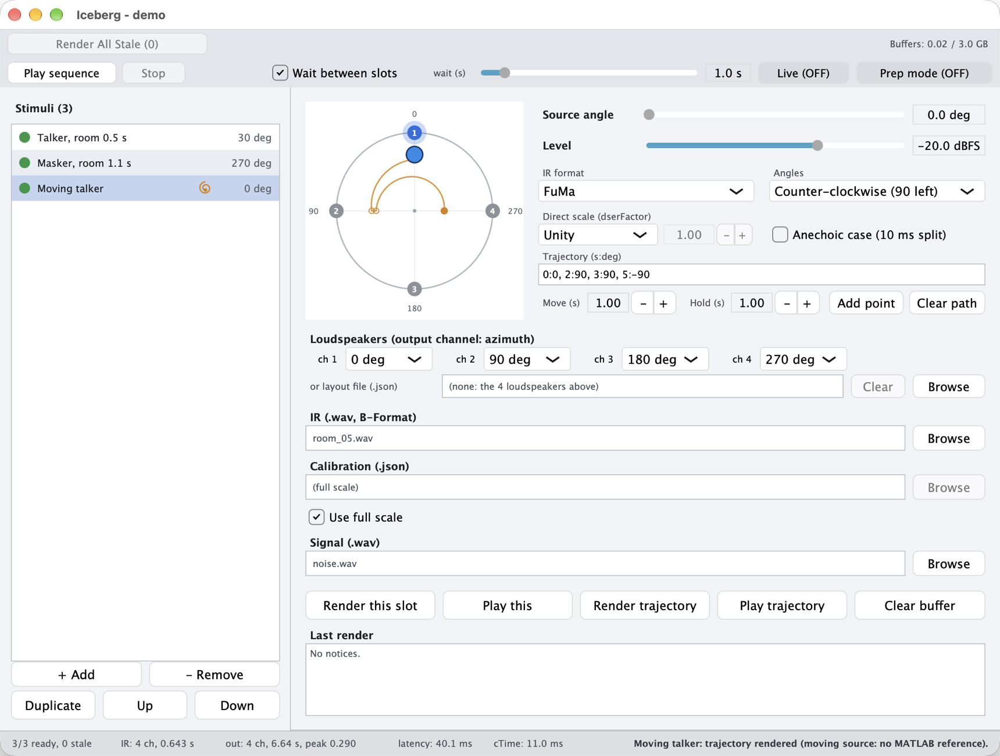

# Iceberg: loudspeaker-based room auralization (C++ library and app)

[](https://aguirresl.github.io/iceberg-cpp/)

Iceberg is a room auralization method for auditory research, proposed in the PhD thesis of
Sergio Aguirre (University of Nottingham, 2023). It reproduces a sound source in a room with
as few as four loudspeakers on a horizontal ring. This repository is its C++
implementation, a library and a standalone app for macOS, Windows and Linux, which
reproduces the reference MATLAB implementation
([aguirreSL/Iceberg](https://github.com/aguirreSL/Iceberg), v1.0.0) to the rounding of
32-bit floats. No MATLAB license is needed to use it.



## Download and run

The latest version, for each system (older versions and the release notes are on the
[Releases page](https://github.com/aguirreSL/iceberg-cpp/releases)):

- macOS (Apple silicon and Intel): [Iceberg-macos.zip](https://github.com/aguirreSL/iceberg-cpp/releases/latest/download/Iceberg-macos.zip).
  Unzip and move `Iceberg.app` to Applications. The app is not signed by Apple yet, so the
  first time it has to be opened with a right-click and *Open*, then *Open* again.
- Windows: [Iceberg-windows-installer.exe](https://github.com/aguirreSL/iceberg-cpp/releases/latest/download/Iceberg-windows-installer.exe).
  If SmartScreen warns, choose *More info*, then *Run anyway*.
- Linux: [Iceberg-linux.tar.gz](https://github.com/aguirreSL/iceberg-cpp/releases/latest/download/Iceberg-linux.tar.gz).
  Unpack and run `Iceberg`.

Playback needs one audio output per loudspeaker (four for the default ring). On a laptop,
Prep mode plays any stimulus in stereo on headphones.

## Context

People with hearing loss are challenged most in noisy social settings, and testing them in
such conditions usually requires a large laboratory. With few loudspeakers, the common
reproduction methods trade one quality for another: first-order Ambisonics conveys the
envelopment of a room but blurs the localization of the source, whereas vector base
amplitude panning (VBAP) localizes sharply but conveys little of the room. Iceberg combines
the two, so that a listening test in a reverberant room can be run with minimal hardware.

## How it works

The room is described by its impulse response (RIR) in Ambisonics B-format, simulated
(*e.g.*, the B-format output of ODEON) or measured. Iceberg splits the RIR at its centre
time ($T_s$):

1. The direct sound and the early reflections, up to $T_s$, are rendered with VBAP, for
   localization.
2. The late reverberation, after $T_s$, is rendered with first-order Ambisonics, for
   envelopment.

The stimulus is convolved with both parts, which pass through the calibration of the
reproduction room (1/3-octave filters and a level alignment per loudspeaker) and are summed
on the loudspeakers.


## Uses

### Audiology and hearing research

A test session is built as a list of stimuli. Each stimulus is a recording (*e.g.*, a
sentence of a speech test) placed at an angle in a room, and it is played at a level in dB
SPL when a calibration of the reproduction room is loaded, or in dBFS without one. The list
plays in order, with a fixed pause between stimuli or waiting for the operator, and the
settings of the session are saved as one `.iceberg-exp` file. Prep mode plays any stimulus
in stereo on headphones, so that a session can be prepared away from the loudspeakers.

Iceberg does not ship speech material; any recording can be used. Each stimulus has
one source, and scenes with several simultaneous sources (*e.g.*, a talker and a masker at
different angles) are not supported in the app yet. Two stimuli can still be presented
together by summing their exported renders in other software.

### Teaching

The app runs on a laptop without MATLAB. The position pad lights the loudspeaker pair that
VBAP pans the source on, and Live mode moves the source while it plays, which can be heard
on headphones in Prep mode. Every render can be exported as a WAV file with one channel per
loudspeaker, for analysis in other software. Three simulated rooms, with reverberation
times of 0, 0.5 and 1.1 s, are available in the Iceberg MATLAB repository
(`src/wavFiles/rt_00`, `rt_05`, `rt_11`) as a starting point; the anechoic one is rendered
with *Anechoic case* on.

### Auralization research

The renderer accepts B-format RIRs of any order in the FuMa, AmbiX and N3D conventions,
reduced to first order, and loudspeaker azimuths counted in either direction. Rings of more
than four loudspeakers are described with a layout file, and layouts of 8 and 24
loudspeakers are among the tested cases. Moving sources are available in two experimental
forms: a source dragged on the pad while it plays, and a trajectory of `time:angle` points
rendered offline. The library is C++17 with a short API, described in
[docs/DEVELOPING.md](docs/DEVELOPING.md).

## Status and validation

This is version 0.2.0 (beta), the first public version.

- The static render matches Iceberg MATLAB v1.0.0 to the rounding of 32-bit floats,
  including the input handling (Ambisonics conventions and orders, the azimuth convention,
  resampling) and the loudspeaker layouts. Over a 5-degree sweep of 216 renders in three
  rooms the differences stay within 1.5e-9 RMS and 1.6e-7 of the peak, and the 8- and
  24-loudspeaker layouts likewise. The reference data, with the MATLAB script that made
  them, are published on Zenodo
  ([doi:10.5281/zenodo.23543831](https://doi.org/10.5281/zenodo.23543831));
  `scripts/get_fixtures.sh` downloads them, and the tests then repeat the comparison.
- The method was evaluated in the thesis with objective measures: binaural cues in three
  simulated rooms and a psychoacoustic model of spatial accuracy, with and without hearing
  aids. That evaluation used the 2020 implementation, whose level stage differs from
  v1.0.0 (see the Iceberg MATLAB README). Validation with participants was not possible
  during the COVID-19 pandemic, and Iceberg has not been evaluated in listening tests yet.
  It is intended for research and is not certified as a medical device.
- Experimental: the room calibration by measurement (*Calibration > Calibrate room*). It
  matches MATLAB within 1e-11 on simulated devices and has not been run on real hardware.
  Loading a `calibration.json` measured with Iceberg MATLAB is the tested path.
- Experimental: moving sources. Held still, they reproduce the static render (222
  renders); a moving source has no MATLAB counterpart.
- 211 library tests. On an Apple M4 Pro, one render of the default stimulus takes 38 ms
  for 1 s of signal, 1.5 s for 30 s, 2.0 s for 1 min and 27 s for 10 min.

## Using the app

Every control has a tooltip. In short:

1. A slot is one stimulus: an impulse response (B-format WAV), a signal, a source angle
   and a level. The signal can be a WAV, AIFF or FLAC file, which keep it exact, or Ogg
   Vorbis or MP3 (MP3 on macOS and Windows), whose encoders change the signal; MP3 also
   delays its start by a few milliseconds. Without a layout file it renders on four
   loudspeakers at 0, 90, 180 and 270 degrees, counter-clockwise (90 is on the left), and
   the channel menus set which output each one uses.
2. With *Use full scale* on, the level is in dBFS and no room calibration is applied. With
   it off, a `calibration.json` is loaded and the level is in dB SPL.
3. *Render this slot* renders the stimulus and *Play this* plays it; *Play sequence* plays
   every rendered slot in order. *File > Save* keeps the experiment as an `.iceberg-exp`
   file.
4. *Live*, next to *Prep mode*, turns *Play this* into *Play live*: the source follows the
   pad while it plays.
5. A trajectory is typed as `time:angle` points, or built by dragging the source and
   pressing *Add point*. *Render trajectory* and *Play trajectory* render and play the
   moving source, and the list of stimuli marks the slot with a spiral.
6. *File > Export ... (WAV)* writes a render to disk as 32-bit float, one channel per
   loudspeaker.

The app follows the light or dark appearance of the operating system; *View > Appearance*
fixes one of them instead.

## Loudspeaker layouts and calibrations

Without a layout file, a stimulus renders on four loudspeakers at 0, 90, 180 and 270
degrees. Other rings are described in a JSON file, loaded in the slot's *layout file* row,
in one of two formats. Angles are in degrees, counter-clockwise by default (0 in front, 90
on the left), and elevations are 0, since the ring is horizontal. A calibration file has
one entry per loudspeaker position of the layout.

A list of loudspeakers, all in use, in the order of the outputs
([examples/layouts/ring8_speakers.json](examples/layouts/ring8_speakers.json)):

```json
{
  "speakers": [
    {"label": "front",      "azimuth": 0,  "elevation": 0},
    {"label": "front-left", "azimuth": 45, "elevation": 0},
    ...
  ]
}
```

A ring as in Iceberg MATLAB's configuration, where every position is an output and only
the listed ones play ([examples/layouts/ring24_4active.json](examples/layouts/ring24_4active.json)).
`lsArray` holds the azimuth of each position, `activeLSNumbers` the positions in use
(counted from 1) and `ls_dir` their azimuth and elevation:

```json
{
  "lsArray": [180, 195, 210, ..., 150, 165],
  "activeLSNumbers": [1, 7, 13, 19],
  "ls_dir": [[180, 0], [270, 0], [0, 0], [90, 0]]
}
```

`examples/calibration` holds the example calibration shipped with Iceberg MATLAB in two
forms: `ring24.json` for the 24-position layout above, and `four_loudspeakers.json` for
the default four loudspeakers (0, 90, 180 and 270 degrees on outputs 1 to 4). They show
the format and let a stimulus be rendered in dB SPL; a real room needs its own calibration
(*Calibration > Calibrate room*, or Iceberg MATLAB).

## Building from source

Clone with `git clone --recursive` to get JUCE, which the app uses. The library needs
CMake and Eigen. The steps, the code layout and the library API are in
[docs/DEVELOPING.md](docs/DEVELOPING.md); the conventions for contributors are in
[CONTRIBUTING.md](CONTRIBUTING.md). Questions and bug reports are welcome in the GitHub
issues.

## How to cite

If you use Iceberg, please cite the thesis
([PDF](https://eprints.nottingham.ac.uk/72207/1/SergioAguirre.pdf)):

```bibtex
@phdthesis{aguirre_2023,
  title  = {Iceberg: a loudspeaker-based room auralization method for auditory research},
  author = {Aguirre, Sergio Luiz},
  school = {University of Nottingham},
  year   = {2023},
  month  = jul,
  url    = {https://repository.nottingham.ac.uk/handle/123456789/58572}
}
```

## Credits

The C++ code reimplements Iceberg MATLAB, which is built on Archontis Politis'
[Vector-Base-Amplitude-Panning](https://github.com/polarch/Vector-Base-Amplitude-Panning)
and [Higher-Order-Ambisonics](https://github.com/polarch/Higher-Order-Ambisonics)
toolboxes (with Ville Pulkki's `vbap()`), and it replicates the numerics of the
[ITA-Toolbox](https://git.rwth-aachen.de/ita/toolbox) (RWTH Aachen) that Iceberg uses. The
app is built with [JUCE](https://juce.com).

## How this was built

The port was written with Claude (Anthropic's AI assistant), under the direction and
review of Sergio Aguirre. Its correctness rests on the comparison with the MATLAB
reference: every stage and every render is tested against data that Iceberg MATLAB
generates (the numbers above), and what has no MATLAB counterpart is labelled
experimental.

The functions that reproduce the numerics of the ITA-Toolbox were written as a clean-room
implementation. Each one was first described in a written specification, based on the
published methods (ISO 3382-1, Lundeby et al. 1995, Kirkeby and Nelson) and on the
behaviour that Iceberg requires, without any source code. A separate Claude session then
implemented it from that specification alone, with no access to the ITA-Toolbox source, to
the Iceberg MATLAB files that replicate it, or to any earlier implementation. These
functions cover the onset and the centre time of the impulse response, the time windows
and the convolution of the render, and the signal processing of the room calibration. The
specifications are in [docs/cleanroom](docs/cleanroom), and the functions are compared
with Iceberg MATLAB in the same way as the rest of the port.

## License

The library, the tests and the build files are under the BSD 3-Clause License
([LICENSE](LICENSE)), as Iceberg MATLAB is. The app in `apps/iceberg-juce` is under the GNU
Affero General Public License, version 3 only (AGPL-3.0-only,
[apps/iceberg-juce/LICENSE](apps/iceberg-juce/LICENSE)), because it is built with JUCE,
whose open-source licence is the AGPLv3. The third-party
components keep their own licences: JUCE (AGPLv3 or commercial), Eigen (MPL 2.0),
nlohmann/json (MIT), pocketfft (BSD 3-Clause) and GoogleTest (BSD 3-Clause, tests only).
[THIRD_PARTY_NOTICES.txt](THIRD_PARTY_NOTICES.txt), which every package carries, gives
their full texts, with those of the libraries JUCE builds into the app and of the MATLAB
toolboxes whose algorithms the library reproduces.
